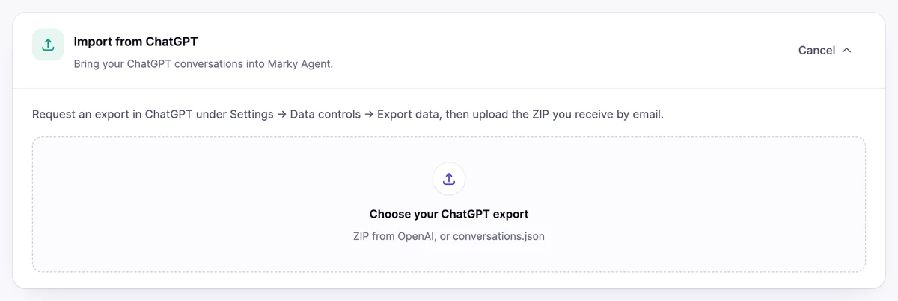
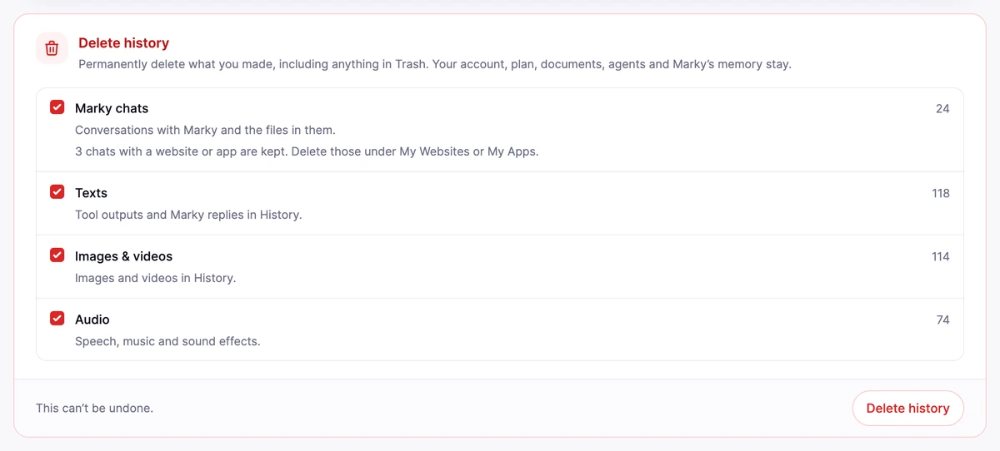

Open [**Settings** > **Data Controls**](https://easy-peasy.ai/settings/data-controls).

## Import your ChatGPT history

Move your ChatGPT conversations into Marky Agent, so you can search them and continue them with any model.

<Frame>
  
</Frame>

<Steps>
  <Step title="Export your data from ChatGPT">
    In ChatGPT, go to **Settings** > **Data controls** > **Export data**. OpenAI emails you a link to a ZIP file, usually within a few minutes to a few hours. Download it.
  </Step>
  <Step title="Choose the file">
    On the **Import from ChatGPT** card, click **Import**, then **Choose your ChatGPT export**, and pick the ZIP, up to 2 GB. The file is read in your browser, and you see how many conversations, messages, and images were found.
  </Step>
  <Step title="Choose the options">
    - **Also teach Marky about me**, on by default, adds what your ChatGPT history says about you, such as your job, projects, and preferences, to [Marky's memory](/marky/memory).
    - **Replace conversations I already imported**: turn it on to import again conversations you imported before. Otherwise they're skipped.
  </Step>
  <Step title="Click Import">
    Keep the tab open until it finishes. Your conversations appear in Marky Agent in a **ChatGPT** folder, with their original dates.
  </Step>
</Steps>

Good to know:

- Images you uploaded to ChatGPT come along. Images ChatGPT generated aren't in OpenAI's export, so they can't be imported.
- Voice conversations are imported as text.
- Importing is free and doesn't use words. Continuing a conversation in Marky uses words as usual.
- Imported conversations are private to you, even on a Teams plan.

## Your websites, apps, and domains

**My Websites** lists the websites and web apps [Marky built](/marky/websites) for you, and **My Apps** the [mobile apps](/marky/websites#mobile-apps). Each one shows its link, whether it's **Public** or a **Draft**, and when it last changed. The ⋯ menu on each has:

| Option | What it does |
| --- | --- |
| **Settings** | Opens the site's settings: its address, custom domain, and more |
| **Open chat** | Opens the Marky chat it was built in |
| **Visit site** | Opens the published site |
| **GitHub** | Opens the linked GitHub repository, if there is one |
| **Delete** | Deletes the site or app |

<Warning>
  **Delete** takes the site offline and deletes its database and files. It can't be undone. The chat it was built in stays, and so do domains you bought for it. Only the owner can delete a site.
</Warning>

**My Domains** lists the domains you bought through Marky, with their status, registration and expiry dates, and whether they renew automatically.

## Delete your history

**Delete history** permanently deletes what you've made, while your account and plan stay. So do your documents, agents, transcriptions, and Marky's memory. Use it to start fresh without [deleting your account](/account/profile#delete-your-account).

<Frame>
  
</Frame>

<Steps>
  <Step title="Choose what to delete">
    All four kinds are ticked to start with, each with how many items you have. Untick what you want to keep.

    - **Marky chats**: conversations with Marky and the files in them.
    - **Texts**: tool outputs and Marky replies in History.
    - **Images & videos**: images and videos in History.
    - **Audio**: speech, music, and sound effects.
  </Step>
  <Step title="Click Delete history">
    The **Delete your history?** window lists what goes. Click **Delete permanently**, and keep the page open until it's done.
  </Step>
</Steps>

<Warning>
  This can't be undone, and it deletes what's in Trash too. Deleting doesn't give back the words or credits those items used.
</Warning>

Chats that hold a website or app are kept, so the site keeps working. Delete those sites under **My Websites** or **My Apps** above.

<Columns cols={2}>
  <Card title="Websites and apps" icon="globe" href="/marky/websites">
    Build and publish with Marky.
  </Card>
  <Card title="Profile and preferences" icon="user" href="/account/profile">
    Your details, or delete your account.
  </Card>
</Columns>
