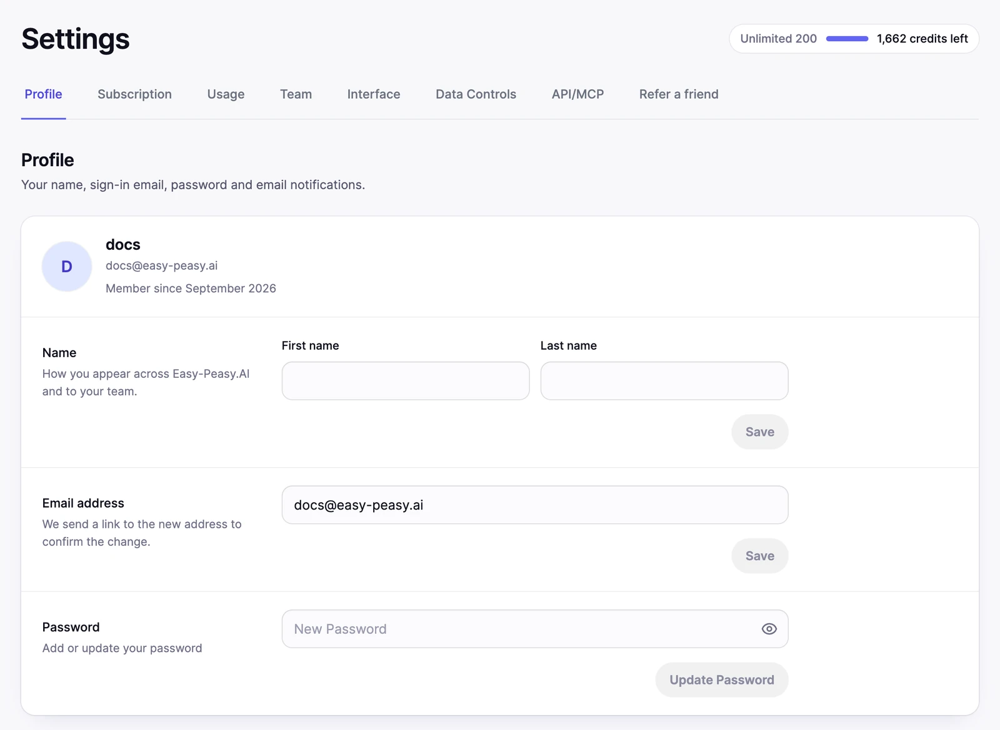
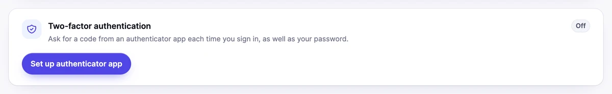
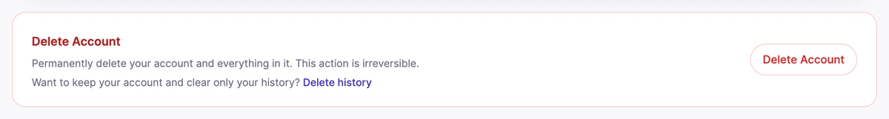

To open **Settings**, click your name at the bottom of the sidebar and choose **Settings**. The **Profile** tab has your account details and sign-in, and **Interface** has the language and theme.

<Frame>
  
</Frame>

## Name and email

- **Name**: fill in **First name** and **Last name** and click **Save**.
- **Email address**: type the new address and click **Save**. We send a confirmation link to the new address; the change takes effect once you click it.

## Password

In the **Password** row, type a **New Password** and click **Update Password**. If you signed up with Google, this adds a password so you can also sign in with your email.

A password needs 12 to 128 characters, with an uppercase letter, a lowercase letter, a number, and a special character. It can't be a common password or contain your email address. The checklist under the field shows what's missing.

If you forget your password, click **Forgot your password?** on the sign-in page to get a reset link.

## Two-factor authentication

With two-factor authentication on, signing in asks for a code from an authenticator app as well as your password.

<Frame>
  
</Frame>

<Steps>
  <Step title="Click Set up authenticator app">
    It's on the **Two-factor authentication** card of the **Profile** tab.
  </Step>
  <Step title="Add Easy-Peasy.AI to your authenticator app">
    Scan the QR code with an app such as Google Authenticator, Microsoft Authenticator, or 1Password. If you can't scan it, click **Can't scan it? Enter a key instead** and type the key into the app. On a phone, **Add to authenticator app** opens the app for you.
  </Step>
  <Step title="Enter the 6-digit code">
    Type the code the app shows. It's checked as soon as you've typed six digits, or click **Turn on**.
  </Step>
</Steps>

The card then shows **On**. From your next sign-in, after your password, you're asked to **Enter your code** from the app.

- **Add another authenticator** sets up a second app, for example on a spare phone, as a backup.
- **Remove** next to an authenticator, then **Remove authenticator**, stops its codes from working. Once you remove the last one, signing in no longer asks for a code.

<Warning>
  There are no backup codes. If you lose your phone, email support@easy-peasy.ai and we'll help you back in. A second authenticator saves you that step.
</Warning>

## Email notifications

The **Email notifications** card has a switch for each kind of email we send about your own work. **Transcriptions** emails you when a recording or uploaded file has finished transcribing. Each of these emails also has a link to turn it off.

## Language and theme

On the **Interface** tab:

- **Language** changes the dashboard's language: English, Japanese, Spanish, French, Italian, German, Korean, Simplified Chinese, Thai, Arabic, Portuguese, Malay, or Vietnamese. In Arabic, the dashboard reads right to left.
- **Theme** switches between **Light**, **Dark**, and **System**, which follows your device's setting. The theme is saved in this browser.

**Theme** and **Language** in the account menu, under your name at the bottom of the sidebar, do the same.

Changing the dashboard language doesn't change what the AI writes. Pick the output language in each [tool](/tools/run), or ask Marky in the language you want.

## Delete your account

<Frame>
  
</Frame>

<Steps>
  <Step title="Click Delete Account">
    It's on the last card of the **Profile** tab.
  </Step>
  <Step title="Type DELETE to confirm">
    In the **Delete your account?** window, type DELETE. You can also tell us why you're leaving. Then click **Delete Account**.
  </Step>
</Steps>

<Warning>
  Deleting your account can't be undone. It cancels your subscriptions straight away, takes down the websites and apps Marky published for you, and deletes your chats, agents, custom voices, and everything you created. Download anything you want to keep first. Domains you bought aren't deleted.
</Warning>

To keep your account and clear only what you made, use [Delete history](/account/data-controls#delete-your-history) instead. To stop paying without deleting your account, [cancel your subscription](/account/subscription#cancel-your-plan).

<Columns cols={2}>
  <Card title="Manage your subscription" icon="credit-card" href="/account/subscription">
    Change plan or cancel.
  </Card>
  <Card title="Data controls" icon="database" href="/account/data-controls">
    Import from ChatGPT, your sites and domains, and delete your history.
  </Card>
</Columns>
