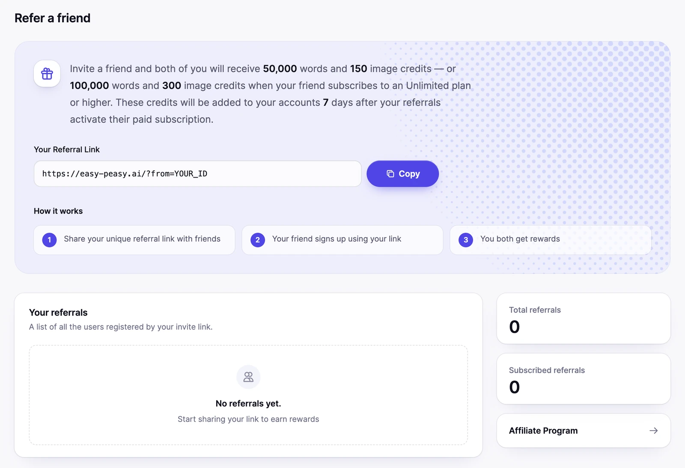

Invite friends to Easy-Peasy.AI. When a friend you invited starts a paid plan, you both get bonus words and image & video credits.

| Your friend subscribes to | You each get |
| --- | --- |
| Unlimited or higher, a Teams plan, or Enterprise | 100,000 words and 300 credits |
| Any other paid plan, such as Starter or Unlimited 50 | 50,000 words and 150 credits |

Signed up through a friend's link? You get the same bonus when you start your paid plan, and you have an invite link of your own to share.

## Invite a friend

<Steps>
  <Step title="Copy your invite link">
    Open [**Settings** > **Refer a friend**](https://easy-peasy.ai/settings/referrals) and click **Copy** next to **Your Referral Link**. On a phone, **Share your link** opens your phone's share options.

    <Frame>
      
    </Frame>
  </Step>
  <Step title="Share it">
    Send the link to friends or post it. They need to sign up through your link to count as your referral.
  </Step>
  <Step title="Get your bonus">
    The bonus is added to both accounts within 7 days after your friend starts a paid subscription, and we email you both.
  </Step>
</Steps>

**Your referrals** lists everyone who signed up with your link, with their status: **Invited**, **Registered**, or **Subscribed**. Next to it, **Total referrals** counts them all and **Subscribed referrals** those who subscribed.

## Your bonus

Your referral bonus goes into the same bonus balances as words and credits you buy:

- **Bonus words** work like your plan's words: Marky Agent, AI Employees, the tools, and agents on some models use them.
- **Bonus credits** work like your plan's image & video credits: they pay for images, videos, and the other visual features. The **Refer a friend** page and our emails call them "image credits"; they're the same thing.

You don't need to do anything to use them. Your plan's monthly allowance is used first, and your bonus only after that runs out. Whatever you don't use carries over when your allowance resets. Your bonus doesn't expire, and if you cancel your plan, you keep it and can use it on the Free plan.

To see your bonus, open [**Settings** > **Usage**](https://easy-peasy.ai/settings/usage): **Bonus words** and **Bonus credits** appear next to what your plan includes. The credits left on your dashboard, in the sidebar, and on **Settings** > **Subscription** count your bonus credits too. [Bonus words and credits](/account/plans-and-credits#bonus-words-and-credits) walks through an example.

## Questions

<AccordionGroup>
  <Accordion title="Will my bonus be gone at the end of the month?">
    No. Only your plan's monthly allowance resets. Your bonus is used after it, and whatever is left carries over to the next month.
  </Accordion>
  <Accordion title="My friend subscribed, but I don't have a bonus">
    Check **Your referrals** on the **Refer a friend** page. Your friend counts once they show as **Subscribed**, and the bonus can take up to 7 days to arrive after that. If they aren't in the list, their sign-up didn't come through your link. Still missing after 7 days? Email support@easy-peasy.ai.
  </Accordion>
</AccordionGroup>

## Affiliate program

To earn money instead of credits, for example if you write about AI tools or run a community, join the affiliate program: click **Affiliate Program** under **Total referrals** and **Subscribed referrals**. Affiliates earn a 30% commission on the payments of the customers they refer, for as long as they stay subscribed.

<Columns cols={2}>
  <Card title="Bonus words and credits" icon="coins" href="/account/plans-and-credits#bonus-words-and-credits">
    How your bonus is used and where to see it.
  </Card>
  <Card title="Buy more credits" icon="cart-shopping" href="/account/buy-credits">
    Top up words and credits.
  </Card>
</Columns>
