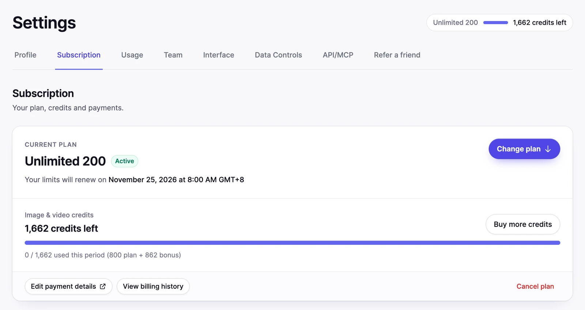
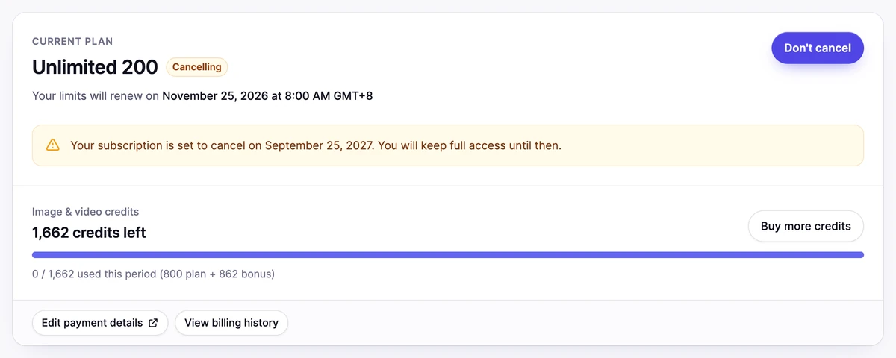

Everything about your plan is on [**Settings** > **Subscription**](https://easy-peasy.ai/settings/billing). You can also click your name at the bottom of the sidebar and choose **Subscription**.

<Frame>
  
</Frame>

The card at the top shows your plan, its status, and the date your limits renew. Under it, **Image & video credits** shows how many credits you have left this period, with **Buy more credits**. Along the bottom of the card:

- **Edit payment details** opens Stripe's secure billing page, where you add or change a card.
- **View billing history** takes you to your invoices and receipts, further down the page.
- **Cancel plan**, at the far right, cancels your subscription.

<Note>
  On a team, only the account owner can manage the subscription. Team members see the owner's plan, marked **Team plan**, and their own credits.
</Note>

## Upgrade or change your plan

<Steps>
  <Step title="Click Change plan">
    It takes you to **Choose your plan**, below the card. Switch between **Monthly** and **Yearly** at the top; yearly billing costs less per month. Click **Show all plans** to see the larger plans.
  </Step>
  <Step title="Click Upgrade on the plan you want">
    Stripe shows what you'll pay today before you confirm. You pay only the price difference, your billing date doesn't change, and the new plan's full allowance applies right away.
  </Step>
  <Step title="Start using it">
    Your new allowance applies as soon as the payment goes through. Check it on [**Settings** > **Usage**](/account/usage).
  </Step>
</Steps>

To move to a cheaper plan, or between monthly and yearly billing, pick the plan the same way. Stripe shows the new price and when the change takes effect before you confirm. A cheaper plan starts at your next renewal; until then, you keep your current plan and its allowance.

## Update your payment method

Click **Edit payment details**, then add a card or change the default one on the Stripe page.

## Download invoices and receipts

Click **View billing history**, or scroll to **Billing history** at the bottom of the page. It lists your payments, including those for subscriptions that have ended. Each one has buttons to download it as a PDF and to view it online, and an unpaid invoice has **Pay now**. Click **Show all** to see the whole list.

If the list doesn't go back far enough, click **Open billing portal** under it to find older payments on Stripe's billing page.

## Free trials

If your plan started with a free trial, the card shows **Free trial** with the days left, the date the trial ends, and what you'll pay after it. During a trial you get the plan's full allowance, except image & video credits, which are limited to 50.

To start paying early and unlock the full credit allowance, click **End trial and start plan now**, then **Start plan now** to confirm. You're charged right away, a new billing period starts today, and you give up the trial days you had left.

## Cancel your plan

<Steps>
  <Step title="Click Cancel plan">
    It's at the bottom right of the plan card.
  </Step>
  <Step title="Confirm">
    Read the notice and click **Yes, cancel my plan**, then finish on the Stripe page. To back out instead, click **Keep my subscription**.
  </Step>
</Steps>

Your plan stays active until the end of the period you've paid for. Until then, the card shows **Cancelling** and the date your subscription ends. After that, your account moves to the Free plan.

<Frame>
  
</Frame>

Changed your mind before then? Click **Don't cancel** on the same card, and your subscription continues as usual.

<Warning>
  Some older plans are no longer sold. If you're on one and cancel, you can't subscribe to it again later.
</Warning>

## If a payment fails

If your card is declined, we email you a link to pay the invoice. Until it's paid, your account works like the Free plan, and **Settings** > **Subscription** shows your plan as **Past due** or **Unpaid**. Pay the invoice from that email, or with **Pay now** under **Billing history**, to restore your plan right away. Then update your card with **Edit payment details** so the next renewal goes through.

## Add-ons

- **Team seats.** Add people to your plan from [**Settings** > **Team**](/account/team) with **Add seats**. Each seat gets the plan's full allowance.
- **Always-On Hosting.** Keeps a website or app that Marky built for you running around the clock. Turn it on for each app in its deployment settings.
- **Extra credits and words.** See [Buy more credits](/account/buy-credits).

## Questions

<AccordionGroup>
  <Accordion title="Do unused credits carry over to the next month?">
    No. Your plan allowance resets every month. Bonus credits and words, whether you bought them or got them for a referral, carry over until you use them. See [Bonus words and credits](/account/plans-and-credits#bonus-words-and-credits).
  </Accordion>
  <Accordion title="What happens to my bonus credits and words if I cancel?">
    You keep them. After your plan ends, you can use them on the Free plan, within its limits.
  </Accordion>
  <Accordion title="I pay yearly. Do I get my whole year of credits at once?">
    No. Yearly plans get the same allowance every month, renewing on the same day each month.
  </Accordion>
  <Accordion title="Can I get a refund?">
    Email support@easy-peasy.ai with your account email and we'll look at it.
  </Accordion>
</AccordionGroup>
