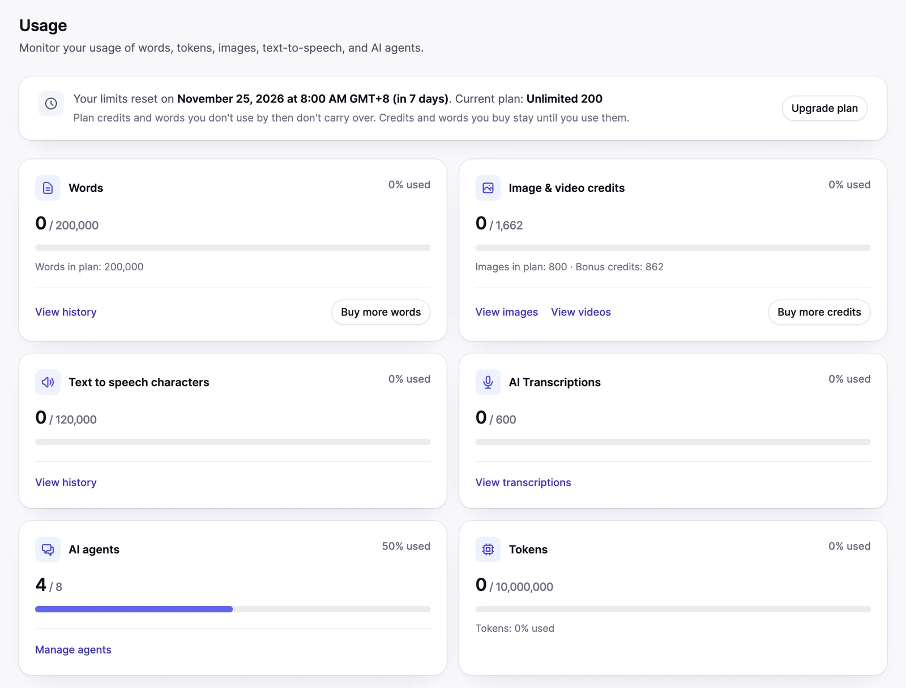

Open [**Settings** > **Usage**](https://easy-peasy.ai/settings/usage). You can also click your name at the bottom of the sidebar and choose **Usage**.

The card at the top says when your limits reset and which plan you're on, with **Upgrade plan**. Below it, each allowance has a card with what you've used this period, out of what you have, and the share used.

<Frame>
  
</Frame>

| Card | What it measures | Links |
| --- | --- | --- |
| **Words** | Words used by Marky Agent, tools, and agents | **View history**, and **Buy more words** on larger plans |
| **Image & video credits** | Credits used by images, videos, and other visual features | **View images**, **View videos**, **Buy more credits** |
| **Text to speech characters** | Characters used by text to speech and the other audio features | **View history** |
| **AI Transcriptions** | Files transcribed | **View transcriptions** |
| **AI agents** | Agents you have, out of your plan's limit | **Manage agents** |
| **Tokens** | A fair-use limit on the total text AI models process for you | |

The words and credits cards count your plan's allowance plus your bonus, whether you bought it or got it for a referral, and show the split under the bar: **Words in plan** and **Bonus words**, **Images in plan** and **Bonus credits**. See [Bonus words and credits](/account/plans-and-credits#bonus-words-and-credits).

A bar turns amber when you've used 85% of an allowance, and red when you've used all of it. See [Plans and credits](/account/plans-and-credits) for how each allowance is counted.

## Daily activity

Below the cards, **Daily Activity** charts one kind of usage at a time, day by day. Choose **Words**, **Credits**, **Text to Speech**, **Transcriptions**, or **Tokens**, then a range: **Last 7 days**, **Last 14 days** (the default), **Last 30 days**, **Last 90 days**, or **Custom** to pick the dates yourself.

## About the tokens limit

**Tokens** counts everything the AI models read and write for you, including long conversations and files. It isn't something you spend like words or credits; it's a safety limit against runaway automation, and most people never get close.

If your usage goes far past it, we'll email you, and the card shows **Upgrade plan**. Very heavy usage can pause the account until you change your plan or buy more words.

## Team usage

On a team, each member has their own allowance. The owner can see everyone's words and credits for this period or any of the 12 before it on [**Settings** > **Team**](/account/team).
