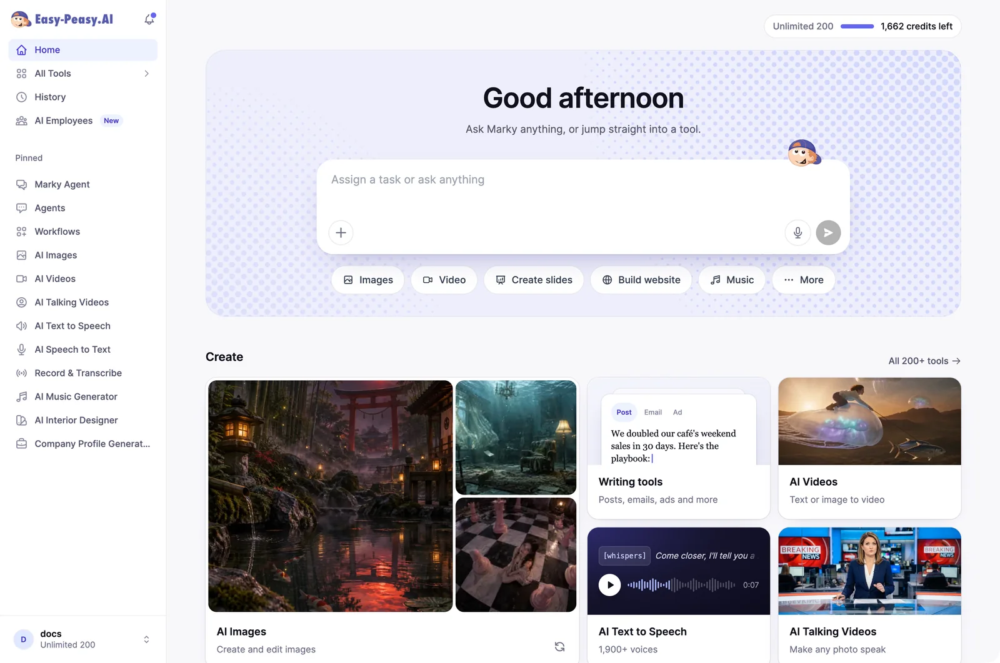
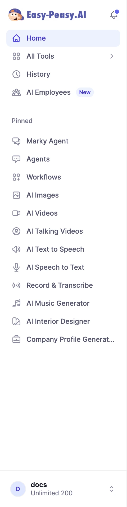
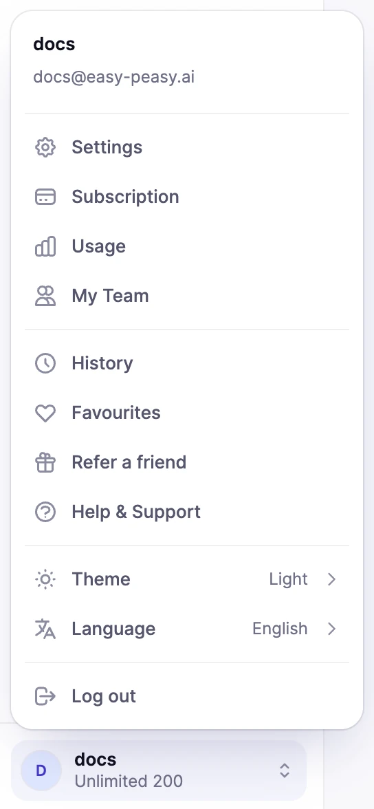

The dashboard is where you'll spend most of your time. Here's what each part does.

<Frame>
  
</Frame>

## Home

From top to bottom, the Home screen has:

- **Your credits.** How many image & video credits you have left this period. Click it to open [**Settings** > **Usage**](/account/usage). On the Free plan, **Upgrade** is next to it. The newest product update can show on the same row, with **Try it**.
- **The prompt box.** Anything you type here goes to [Marky Agent](/marky/overview), which opens a chat with the result. The buttons under it (**Images**, **Video**, **Create slides**, **Build website**, **Music**, and **More**) tell Marky what kind of job it is and show examples or templates to start from. **More** has **Create game**, **Audio**, **Build app**, **Search**, **Academic**, and **Deep Research**.
- **Create.** Cards for the main products, such as AI Images, writing tools, AI Videos, text to speech, talking videos, and AI Employees, then a row of shortcuts with the tools you've starred first. **All 200+ tools** opens [All Tools](/tools/overview).
- **Jump back in.** Your latest images and videos, and your latest Marky chats. **Open history** opens [History](/get-started/history).
- **Trending templates.** Popular image and video templates. **Browse all** shows all of them.
- **What's new.** The latest product updates, each with **Try it**. **All updates** opens the full list.
- **Invite friends, earn credits.** **Copy invite link** copies your [referral link](/account/referrals).

## The sidebar

<Frame>
  
</Frame>

- **The bell** next to the logo opens **What's new** on the Home screen. A dot means there's an update you haven't seen.
- **Home**, **All Tools**, **History**, and **AI Employees** are always at the top. Point at **All Tools**, or click its arrow, to see every tool by category.
- **Pinned** lists the tools you pinned. New accounts start with the main products (Marky Agent, Agents, Workflows, AI Images, AI Videos, and more) already there.
- **Your name and plan** are at the bottom. Click them to open the [account menu](#the-account-menu). On the Free plan, the credits you have left show just above them, with **Upgrade**.

To pin a tool, click the pin next to it in the **All Tools** panel, or the star on its card on the [All Tools](/tools/overview) page. To unpin one, point at it in the sidebar and click its pin.

On some pages, such as AI Images and AI Videos, the sidebar shrinks to a column of icons; point at one to see its name. On a phone, use the tab bar at the bottom of the screen, and **Menu** for everything else.

## The account menu

Click your name at the bottom of the sidebar to open it.

<Frame>
  
</Frame>

| Item | What it does |
| --- | --- |
| **Settings** | Opens [Settings](#settings) on the **Profile** tab |
| **Subscription**, **Usage**, **My Team** | Open those Settings tabs: [Subscription](/account/subscription), [Usage](/account/usage), and [Team](/account/team) |
| **History**, **Favourites** | Open [History](/get-started/history), or its **Favorites** tab |
| **Refer a friend** | Your [invite link and referrals](/account/referrals) |
| **Help & Support** | Answers to common questions, a live chat, and our email address |
| **Theme** | Light, dark, or your device's setting |
| **Language** | The dashboard's language |
| **Log out** | Signs you out |

## History

**History** keeps everything you create. It's split into tabs: **Text** (tool results and Marky conversations), **Images**, **Videos**, **Favorites**, **AI Text-to-Speech**, **Music**, **Sound Effects**, **AI Audio Generator**, and **Trash**. Use the search box to find something by its text.

Deleted text results, images, and videos go to **Trash** first, so you can restore them. See [History and trash](/get-started/history).

## Settings

Open **Settings** from the [account menu](#the-account-menu).

| Tab | What's there |
| --- | --- |
| **Profile** | Your name, sign-in email, password, two-factor authentication, and email notifications. You can also delete your account here. See [Profile and preferences](/account/profile). |
| **Subscription** | Your plan, credits, payment details, and invoices. See [Manage your subscription](/account/subscription). |
| **Usage** | How much of this period's allowances you've used, and your usage day by day. See [Check your usage](/account/usage). |
| **Team** | Seats, invitations, and each member's usage. See [Teams](/account/team). |
| **Interface** | Dashboard language and theme. See [Language and theme](/account/profile#language-and-theme). |
| **Data Controls** | Import your ChatGPT conversations, manage the websites, apps, and domains Marky built for you, and delete your history. See [Data controls](/account/data-controls). |
| **API/MCP** | API keys and the MCP server connection. See [Developers](/developers/overview). |
| **Refer a friend** | Your referral link and bonuses. See [Refer a friend](/account/referrals). |

Once you sign the BAA, a **HIPAA BAA** tab appears before **Refer a friend**. See [HIPAA and the BAA](/account/hipaa).

## Getting help

**Help & Support**, in the account menu, has answers to common questions, a live chat, and our email address, support@easy-peasy.ai.
